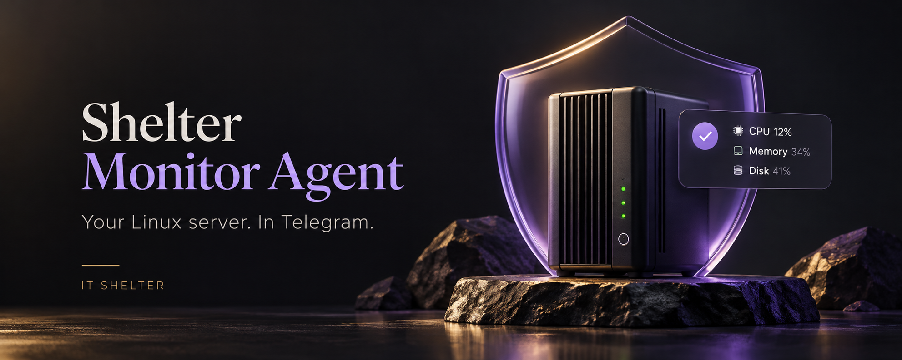
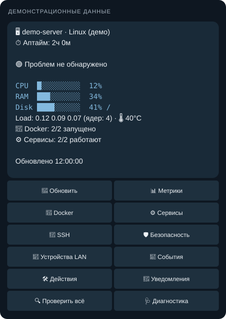
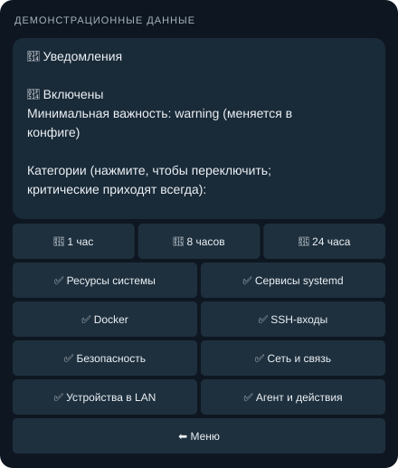

<p align="center"></p>

# Shelter Monitor Agent

**Linux server status, problem alerts, and everyday actions in Telegram.**

[Русский](README.md) · [Download a release](https://github.com/IT-Shelter-Labs/shelter-monitor-agent/releases/latest) · [Operations guide](docs/GUIDE_EN.md) · [Telegram IT Shelter](https://t.me/+ihTcvubt-_BhZTQ6)

[](https://github.com/IT-Shelter-Labs/shelter-monitor-agent/actions/workflows/ci.yml)


Install the agent on a home server or VPS. It collects metrics and sends changes to your own Telegram bot. Check disk space, inspect a container, or restart an allowed service from your phone without opening SSH for a routine status check.

The code and database live on your server. The interface uses the Telegram Bot API; no web dashboard or hosted management account is required. **The bot UI is currently in Russian.** Both Russian and English documentation are provided.

## Features

| Area | What it does |
|---|---|
| Resources | CPU, RAM, swap, disks, load average, uptime, network traffic, temperature when a sensor is available |
| Docker | Container state and health, recent logs, change notifications |
| Services | Selected systemd units and units entering `failed` state |
| SSH | Successful logins, failed attempts, brute-force detection, login after repeated failures |
| Security | Port scans from firewall logs, external connections to selected ports, a daily summary |
| LAN | New devices identified by MAC address, trusted devices, Docker network exclusion |
| Notifications | Severity thresholds, categories, temporary muting, recovery messages |
| Actions | Start, stop, and restart allowed containers; restart services or the agent; prune Docker |
| Diagnostics | On-demand checks and `/diag` with missing-access and configuration hints |
| Availability | Heartbeats to an external service or the included Shelter Watchdog on another machine |

Resource alerts are sent on state changes rather than every polling cycle. Events and notification preferences are stored in SQLite. Python 3.11+ needs only the standard library; Python 3.10 also needs the `tomli` TOML parser.

## Interface

<table>
<tr><th>Server overview</th><th>Notification settings</th></tr>
<tr>
<td width="50%"></td>
<td width="50%"></td>
</tr>
</table>

These panels use synthetic demonstration data and the bot's own text and button definitions. No real server details are used. [Image notes](docs/assets/README.md).

## Quick start with Docker

Use **Docker Engine and Docker Compose on the Linux server being monitored**. Docker Desktop on Windows or macOS is not a suitable host-monitoring deployment. The image is built locally from this repository; no prebuilt registry image is required.

### 1. Get the code and create a config

```bash
git clone https://github.com/IT-Shelter-Labs/shelter-monitor-agent.git
cd shelter-monitor-agent
git checkout v0.1.0
cp config/agent.example.toml config.toml
chmod 600 config.toml
docker compose build
```

If you downloaded a release archive, extract it, open its directory, and start at the `cp` command.

### 2. Connect your bot

Create a bot with `/newbot` in [@BotFather](https://t.me/BotFather). Edit the **existing** `[telegram]` section of `config.toml`:

```toml
[telegram]
token = "YOUR_BOT_TOKEN"
admin_ids = [123456789]
```

Replace `123456789` with your numeric Telegram user ID. To find it, save your bot token in the config first, then run:

```bash
docker compose run --rm shelter-agent agent get-chat-id
```

Send any message to your bot. Copy the `user id` printed in the terminal into `admin_ids`, stop the command with Ctrl+C, and save the config. Do not run `get-chat-id` alongside the agent: both poll the same bot.

### 3. Start and verify

```bash
docker compose run --rm shelter-agent agent check-config --quiet
docker compose up -d
docker compose logs --tail=50
```

Send `/start`, then `/diag` to your bot. Check access to Docker, systemd, logs, and the intended LAN subnet. For group notifications, set `notify_chat_ids`. Only users in `admin_ids` can operate the bot; `/id` is public to help with setup.

## Install without Docker

For Debian 12+ or Ubuntu 22.04+ with systemd and Python 3.10+:

```bash
git clone https://github.com/IT-Shelter-Labs/shelter-monitor-agent.git
cd shelter-monitor-agent
git checkout v0.1.0
sudo ./scripts/install.sh --no-start
sudo nano /etc/shelter-agent/config.toml
sudo shelter-agent get-chat-id
```

Save your token first, obtain your ID, and add it to `admin_ids`. Then:

```bash
sudo shelter-agent check-config --quiet
sudo shelter-agent test-telegram
sudo systemctl restart shelter-agent
journalctl -u shelter-agent -f
```

The installer creates the `shelter` user, copies code into `/opt/shelter-monitor`, and installs the service. If Docker access is unnecessary, use `--no-docker-group` and disable `[docker].enabled`. [Installation details](docs/GUIDE_EN.md#native-installation).

## Telegram commands

| Command | Purpose |
|---|---|
| `/start`, `/status` | Overview and main menu |
| `/metrics` | Detailed metrics |
| `/docker`, `/services` | Containers and systemd services |
| `/ssh`, `/security` | Logins and security events |
| `/devices`, `/events` | LAN devices and event history |
| `/check`, `/diag` | Run checks now; inspect deployment configuration |
| `/notify`, `/mute 2h`, `/unmute` | Categories and notification muting |
| `/actions` | Available actions |
| `/help`, `/id` | Help; user and chat IDs |

## Configuration and permissions

See [agent.example.toml](config/agent.example.toml). Edit existing TOML sections rather than duplicating them. Restart the agent after saving changes.

- Authorization uses **numeric user IDs**, not usernames.
- Mutating actions require confirmation by the same user, are restricted by configuration, and are audited. Arbitrary shell commands are not supported.
- **Actions are allowed on all containers by default**, as well as monitored services. Narrow `[actions]` or disable all actions with `[telegram].allow_actions = false`.
- Access to `docker.sock` or membership in the `docker` group effectively grants root privileges on the host. Disable the module and omit that access if unnecessary.
- Preserve host networking and host mounts from [docker-compose.yml](docker-compose.yml). The optional `SYS_ADMIN` capability enables host service restarts and broadens container privileges.
- Restrict config permissions. Do not publish bot tokens, the database, or unredacted screenshots.

An example restriction within the existing `[actions]` section:

```toml
containers = ["web-*", "nextcloud"]
container_stop = false
allow_monitored_services = false
services = ["nginx"]
docker_prune = false
agent_restart = false
```

## Detecting a full server outage

An agent cannot send a message while its server is powered off. Enable `[heartbeat]` and configure an **external observer**, such as Healthchecks.io or Shelter Watchdog on another machine. Watchdog supports multiple agents. [Heartbeat and TLS setup](docs/GUIDE_EN.md#heartbeat-and-watchdog).

After recovery, the agent also uses saved liveness records to report a possible crash or reboot. This does not replace external monitoring or determine an exact hardware failure cause.

## Troubleshooting

| Problem | Check |
|---|---|
| Bot is silent | Press Start, verify the token and `admin_ids`, inspect `docker compose logs --tail=100` |
| `HTTP 409` | Another agent or `get-chat-id` is polling this token. Use one polling agent per bot |
| systemd is unavailable | Check `/diag` and the `/run/systemd` mount. Process-based status is approximate; service alerts are disabled in this mode |
| LAN shows containers or the wrong subnet | Check `network_mode: host`, `[lan].subnets`, and your real LAN; do not scan Docker subnets |
| No SSH or firewall events | Check log access and sources in `/diag`; port-scan detection needs firewall logging |
| Service restart denied | Native installs need sudoers rules for specific units; Docker installs need the documented capabilities |

The agent reports suspicious events; **it does not block IPs**. Selected-port monitoring cannot see connections handled inside Docker container network namespaces. A web dashboard, metric-history charts, SMART/RAID monitoring, and a deb package are not implemented yet.

## Updates and development

Back up the configuration and data, then select the desired release tag:

```bash
git fetch --tags
git checkout v0.1.0  # replace with the desired release tag
docker compose up -d --build
```

SQLite lives in the `shelter-data` volume and survives normal container recreation. For native installations, rerun `sudo ./scripts/install.sh` after checking out the desired tag.

Run checks on Linux:

```bash
python3 -m unittest discover -s tests -t . -v
ruff check shelter_monitor tests
shellcheck scripts/*.sh
```

CI covers Python 3.10–3.13, linters, Docker builds, and compose validation. [Architecture, CLI, watchdog, and operations](docs/GUIDE_EN.md).

## IT Shelter

[Telegram channel](https://t.me/+ihTcvubt-_BhZTQ6) · [More projects](https://github.com/IT-Shelter-Labs) · [Report a bug](https://github.com/IT-Shelter-Labs/shelter-monitor-agent/issues)

Include the version, installation method, and `/diag` output in bug reports. Hide tokens, IP addresses, and other private details before sharing.
